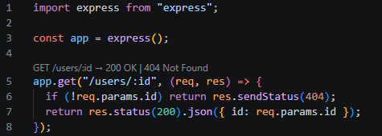

<p align="center">
  
</p>

<p align="center">
  <strong>Possible HTTP response statuses, shown right above your Express and native Fastify routes — while you read and edit.</strong><br />
  Static analysis only. No app to run, no requests to make, no response branches to hunt down by hand.
</p>

<p align="center">
  <a href="https://github.com/katniis/vscode-http-status-lens/releases/latest"></a>
  <a href="https://github.com/katniis/vscode-http-status-lens/blob/main/LICENSE"></a>
  <a href="https://code.visualstudio.com/"></a>
  
  <a href="https://github.com/katniis/vscode-http-status-lens/stargazers"></a>
</p>

<p align="center">
  <a href="https://github.com/katniis/vscode-http-status-lens/releases/latest"><strong>Download the latest VSIX</strong></a>
  &nbsp;·&nbsp;
  <a href="#quick-start">Quick start</a>
  &nbsp;·&nbsp;
  <a href="#features">Features</a>
  &nbsp;·&nbsp;
  <a href="#supported-code">Supported code</a>
  &nbsp;·&nbsp;
  <a href="#development">Development</a>
</p>

---

## Why HTTP Status Lens?

When a handler has several response branches, the possible statuses are easy to miss. You have to read every `return`, every helper call, and every fall-through path just to answer one question: *what can this route actually return?*

HTTP Status Lens brings that answer up to the route declaration:

```text
GET /users/:id → 200 OK | 404 Not Found
```

That line means the handler contains paths that return either status. It does not predict which one will run — results are source-level possibilities from static analysis, not runtime guarantees. The extension does not run your application or make HTTP requests.

<p align="center">
  
</p>

## Contents

- [Quick start](#quick-start)
- [Features](#features)
- [Supported code](#supported-code)
- [Configuration](#configuration)
- [Limits](#limits)
- [Roadmap](#roadmap)
- [Privacy](#privacy)
- [Development](#development)
- [Contributing](#contributing)
- [License](#license)

## Quick start

### Install from a release (recommended)

1. Download `http-status-lens-0.2.0.vsix` from [GitHub Releases](https://github.com/katniis/vscode-http-status-lens/releases/latest).
2. In **Visual Studio Code** (not Visual Studio), open the Extensions view.
3. Select **… → Install from VSIX…** and choose the downloaded file.

Or from a terminal:

```sh
code --install-extension ./http-status-lens-0.2.0.vsix
```

> If Visual Studio's VSIX Installer reports “One or more extensions are for Visual Studio Code. Try installing them in Visual Studio Code,” close that installer and install the file from VS Code using the steps above.

### Try it

Open a supported Express or native Fastify `.js` or `.ts` file. A CodeLens above each recognized route lists the possible response statuses:

```ts
app.get("/users/:id", (req, res) => {
  const user = findUser(req.params.id);
  if (!user) return res.status(404).json({ error: "Not found" });
  res.json(user);
});
```

```text
GET /users/:id → 200 OK (implicit) | 404 Not Found
```

### Build and install from source

From a checkout of this repository:

```sh
npm install
npm run package -- --no-rewrite-relative-links
code --install-extension ./http-status-lens-0.2.0.vsix
```

> If the screenshot is missing from Extension Details after updating the README, rebuild and reinstall the VSIX so it contains the latest README.

## Features

| Feature | What you get |
| --- | --- |
| **Route CodeLens** | A read-only CodeLens above supported Express and Fastify routes, e.g. `GET /users/:id → 200 OK \| 404 Not Found`, in numeric order |
| **Color-coded statuses** | Explicit response status literals in source are color-coded at a glance |
| **Hover explanations** | Hover explanations on recognized Express and Fastify status literals |
| **IntelliSense shortcuts** | Type `rs404` / `rss404` and accept with Tab or Enter — see below |

IntelliSense shortcuts adapt to the framework:

- **Express:** `rs404` → `res.status(404)`, `rss404` → `res.sendStatus(404)`
- **Fastify:** the same shortcuts insert `reply.code(404)` or `reply.code(404).send()`, using the handler's reply parameter name

Details worth knowing:

- Inferred defaults are marked `(implicit)`.
- Unresolvable expressions show as `dynamic status`; when nothing can be proven, the lens shows `No direct status detected`.
- In a clear handler branch, the matching IntelliSense status is ranked first. All recognized statuses remain available and nothing expands automatically.
- VS Code renders a CodeLens title as plain text, so its method, route, and status segments cannot be colored independently.

## Supported code

| Area | Supported |
| --- | --- |
| **Files** | File-backed `.js`, `.cjs`, `.mjs`, `.ts`, `.cts`, `.mts` documents |
| **Express apps & routers** | `express()`, `express.Router()`, imported `Router()`; route methods and `router.route(path)` chains |
| **Native Fastify** | Instances created with `fastify()`; route shorthands and `fastify.route({ method, url/path, handler })`. Method arrays appear as one combined route summary |
| **Fastify plugins** | Static local plugins registered with `.register()` are followed recursively, with static prefixes applied, up to 64 imported plugin levels |
| **Handlers** | Inline handlers, same-file function declarations, variables initialized directly with arrow/function expressions, and directly imported relative ES module handlers (named, aliased, and default exports, across JS/TS). The second handler parameter is the response/reply object, whatever its name |
| **Express status calls** | `res.status(code)`, `res.sendStatus(code)` |
| **Fastify status forms** | `reply.code(code)`, `reply.status(code)`, `reply.statusCode = code`, redirects, sends, and returned handler values |

Explicit numeric status calls in supported JavaScript and TypeScript files are color-coded even when the file contains only controller handlers and no route declaration. Editing an imported handler refreshes the route summary in its importing file.

## Configuration

Hide the route CodeLens with `httpStatusLens.showCodeLens` in VS Code Settings or `settings.json`:

```json
{
  "httpStatusLens.showCodeLens": false
}
```

## Limits

This is conservative static analysis. Results do not prove which branch will run or what the application will return at runtime.

- Package imports, path aliases, barrel re-exports, and handler factories are not followed. Route summaries do not follow status-setting calls made inside helper functions invoked by a handler.
- Fastify plugin traversal is limited to statically resolved relative local plugins and stops after 64 imported plugin levels. Runtime-generated Fastify routes are not resolved. NestJS applications using `FastifyAdapter` are not analyzed as native Fastify route registrations.
- `app.use()` / `router.use()`, mounted Express router prefixes, aliases/reassigned app or router variables, named status constants, and arbitrary dynamic expressions are not resolved.
- JSX/TSX, Vue, Svelte, generated files, and non-file documents are not supported.
- Nested callback responses, class/object method handlers, low-level Node APIs such as Express `res.statusCode` and `res.writeHead`, exceptions, and `next(error)` do not contribute statuses.
- Complex control flow can hide an implicit result; uncertain defaults are omitted rather than guessed.

## Roadmap

Support for additional web frameworks and languages beyond Express, native Fastify, and JavaScript/TypeScript is a future direction. NestJS applications using `FastifyAdapter` are not covered by native Fastify analysis.

## Privacy

Analysis runs locally on the current document and directly imported handler files needed to resolve route summaries. The extension does not index the workspace, execute source code or requests, make network calls, send telemetry, or write to workspace files. It works in untrusted workspaces.

## Development

Requires Node.js 22 or newer for development tools and VS Code 1.142.0 or newer. The packaged extension targets the Node.js 20 runtime available in its supported VS Code host.

| Command | Purpose |
| --- | --- |
| `npm run check` | Type-check source and tests |
| `npm run lint` | Lint with ESLint |
| `npm run build` | Bundle the extension with esbuild |
| `npm test` | Unit tests plus the VS Code smoke test |
| `npm run package` | Build and produce the `.vsix` |

```sh
npm install
npm run check
npm run lint
npm run build
npm test
npm run package
```

The unit tests exercise the analyzer and formatting logic; the smoke test launches an isolated VS Code 1.142 extension host.

For opt-in performance measurements, build/package first, then run `npm run benchmark -- baseline-01` (or use a distinct label such as `candidate-01`). The command records cold and warm analysis, completion latency, process heap/RSS, and bundle/VSIX sizes under the ignored `benchmark-output/` directory. For comparable results, use the same machine, Node.js version, and VS Code test version for ten baseline and ten candidate runs. Timings are diagnostic and are not CI gates. Set `HTTP_STATUS_TEST_VSCODE` to an existing isolated VS Code test executable to avoid downloading the test host; the runner uses a separate test profile and never attaches to an open editor window.

See [the optimization measurements](docs/performance-results.md) for the paired results and parser evaluation.

## Contributing

Bug reports and focused pull requests are welcome. Run `npm run check`, `npm run lint`, and `npm test` before submitting a change.

## License

MIT. See [LICENSE](LICENSE).

<p align="center">
  
</p>
